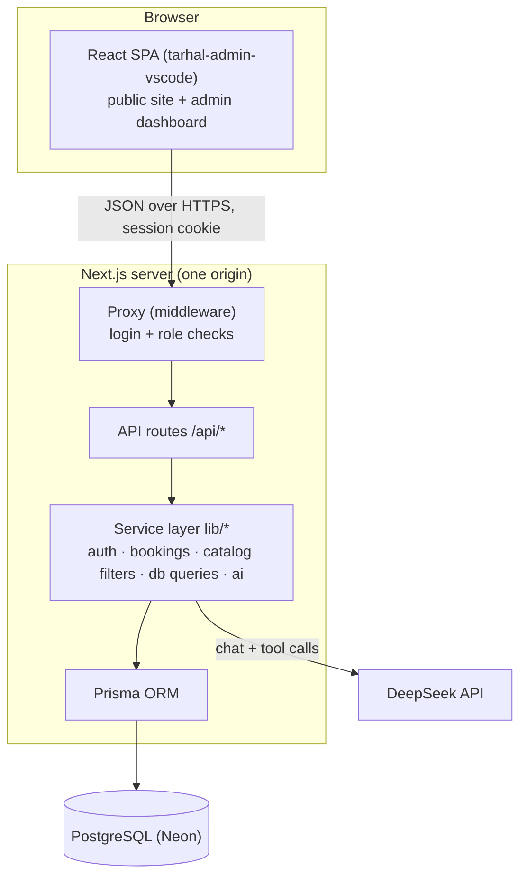
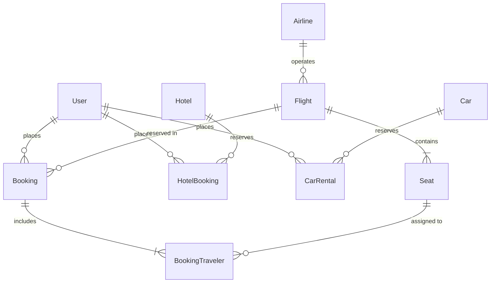
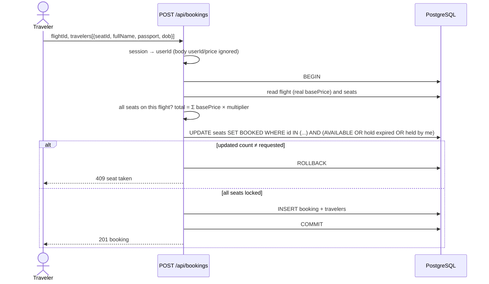

# Tarhal (ترحال) — Software Design Description (SDD)

> **Status:** DRAFT for the 14 Nov 2026 submission · **Course:** CSC 305 · **Prepared:** 7 Nov 2026
> Describes the system **as built** in the repository on 7 Nov 2026 (schema v3), plus the planned parts marked *Planned*. Sections marked ✍️ need team input before submission.

## Contents
1. Introduction
2. System Overview
3. Architectural Design
4. Data Design
5. Component Design
6. Interface Design
7. Security Design
8. Deployment Design
9. Design Decisions and Trade-offs
10. Requirements Traceability
11. Open Items

---

## 1. Introduction

### 1.1 Purpose
This document describes the software design of Tarhal: its architecture, data model, components, interfaces and the main design decisions. It is written for the development team, the course instructor, and anyone maintaining the system.

### 1.2 Scope
Tarhal is a web-based online travel agency (OTA) for Saudi Arabia. Travelers search and book flights with seat selection, browse hotels and rental cars, and ask an AI travel assistant in Arabic or English. Administrators manage flights and view bookings. Payments, hotel/car booking flows, the destination guide and itinerary generator are designed but not yet implemented (section 11).

### 1.3 Definitions
| Term | Meaning |
|---|---|
| OTA | Online Travel Agency |
| API route | A server endpoint under `/api/*` in Next.js |
| Seat hold | A temporary reservation (`HELD` + `heldUntil`) that expires after 10 minutes |
| Session | Signed HTTP-only cookie `tarhal_session` identifying the logged-in user |
| SPA | Single-page application (the React frontend) |
| IATA code | Airline (`SV`) or airport (`RUH`) code |

### 1.4 References
- SPMP (submitted 3 Oct 2026), SRS (submitted 24 Oct 2026) ✍️ *add links / section numbers*
- `docs/api-documentation.md` — full API reference with real responses
- `Update.md` — schema v3 change specification
- `docs/class-diagram-v2.md` (v3 content in PR #34) — class diagram
- `docs/booking-sequence-diagram.md`, `docs/auth-sequence-diagram.md`, `docs/hotels-cars-sequence-diagram.md`
- `docs/deployment.md`, `docs/AI_COST.md`

---

## 2. System Overview

| Actor | Main goals |
|---|---|
| Traveler | Register, log in, search flights, choose seats, book, view and cancel bookings, browse hotels and cars, chat with the AI assistant |
| Administrator | Log in, view and add/edit flights, view all bookings, manage catalog data |
| AI model (DeepSeek, external) | Answer travel questions using Tarhal data first, the web second |

**Main use case — book a flight:** search (from, to, date) → choose a flight → see the seat map → choose seats and enter traveler details → the server reserves the seats atomically and calculates the price → booking appears in "My bookings" → the traveler may cancel, which releases the seats.

---

## 3. Architectural Design

### 3.1 Style
A **layered client–server** architecture in a single Next.js deployment:

**Core rule:** the browser never talks to the database. Every read and write goes through an API route, which validates input, checks the session, and uses Prisma.

### 3.2 Subsystems
| Subsystem | Code | Responsibility | Owner |
|---|---|---|---|
| Presentation | `tarhal-admin-vscode/src` (pages, components, services, i18n) | Public site, login/register, stays, rentals, admin dashboard; AR/EN; dark/light | Omar, Tariq |
| Access control | `proxy.ts`, `lib/auth.ts`, `lib/session-token.ts`, `lib/auth-http.ts` | Sessions, role checks, same-origin checks | Mohammed Alasad |
| Accounts | `app/api/auth/*`, `lib/passwords.ts`, `lib/registration.ts`, `lib/password-reset.ts` | Register, login, logout, password recovery | Mohammed Alasad |
| Flights & bookings | `app/api/flights/*`, `app/api/bookings/*`, `lib/bookings.ts` | Search, seat map, atomic booking, my bookings, cancel | Abdulelah |
| Catalog | `app/api/hotels`, `app/api/cars`, `lib/catalog-filters.ts` | Filtered, paginated hotel and car lists | Mohammed Alasad |
| Administration | `app/api/admin/[...slug]`, `lib/db/queries.ts` | Admin flight, airline and booking data | Saud |
| AI assistant | `app/api/ai/chat`, `lib/ai/*`, `components/ChatWidget.tsx` | Chat, tool use over Tarhal data, web search, language guard | Alwaleed |
| Data | `prisma/schema.prisma`, `prisma/migrations`, `prisma/seed.ts` | Schema, migrations, demo data | Abdulelah (design), Saud (implementation) |

---

## 4. Data Design

### 4.1 Entity–relationship model (schema v3)

### 4.2 Data dictionary (main fields)
| Entity | Key fields | Notes |
|---|---|---|
| User | `id`, `name`, `email` (UK), `phoneNumber` (UK), `password` (scrypt hash), `dateOfBirth`, `role` (`TRAVELER`/`ADMIN`) | |
| Airline | `name`, `nameAr`, `iataCode` (UK), `logoUrl` | |
| Flight | `flightNumber` (UK), `airlineId` (FK), `from`, `to` (airport codes), `departureTime`, `arrivalTime`, `basePrice` (Decimal) | index on (`from`, `to`, `departureTime`) |
| Seat | `flightId` (FK), `seatCode`, `ticketClass` (`ECONOMY`/`BUSINESS`/`FIRST`), `priceMultiplier`, `status` (`AVAILABLE`/`HELD`/`BOOKED`), `heldUntil`, `heldByUserId` | unique (`flightId`, `seatCode`) |
| Booking | `userId`, `flightId`, `basePrice`, `luggageFee`, `discount`, `totalPrice`, `paymentStatus`, `isActive` | `isActive = false` means cancelled |
| BookingTraveler | `bookingId`, `seatId`, `fullName`, `passportNumber`, `dateOfBirth` | one per seat; a seat keeps history across cancelled bookings |
| Hotel | `name`, `city`, `address`, `pricePerNight`, `rating`, `roomType`, `imageUrl` | index on `city` |
| HotelBooking | `userId`, `hotelId`, `checkIn`, `checkOut`, `guests`, `totalPrice`, `paymentStatus`, `isActive` | *Planned* API |
| Car | `make`, `model`, `year`, `seats`, `category`, `transmission`, `city`, `pricePerDay`, `insurancePricePerDay`, `isAvailable`, `imageUrl` | index on `city` |
| CarRental | `userId`, `carId`, `pickupDate`, `returnDate`, `withInsurance`, `totalPrice`, `paymentStatus`, `isActive` | *Planned* API |

All entities have `createdAt` / `updatedAt`. Money uses `Decimal(10,2)` (multipliers `Decimal(4,2)`) to avoid floating-point errors.

### 4.3 Integrity rules
- Deleting a user deletes their bookings (cascade); deleting a hotel or car that has bookings is blocked (restrict) so history is kept.
- A seat can be `BOOKED` by only one active booking: enforced by a conditional update inside a transaction (5.3), not by a unique key, so cancelled bookings keep their passenger history.
- Migrations: `20260917110554_init_airlines_schema` (v1) and `20261107120000_schema_v3`. v3 runs only on empty tables; existing databases are reset and re-seeded.

---

## 5. Component Design

### 5.1 Session authentication
- **Register:** validate name, email, phone (`+`, 8–15 digits), password (12–128), date of birth; hash with **scrypt** (random salt); unique email/phone → `409`.
- **Login:** find the user by email (or unique name), verify the hash in constant time, then issue the session token `base64url(payload).HMAC-SHA256(payload)` where payload = `{ sub: userId, exp: now + 7 days, version: HMAC(passwordHash) }`. Stored in an HTTP-only, `SameSite=Lax` cookie (`Secure` in production).
- **Every request:** `getCurrentUser()` verifies the signature and expiry, loads the user, and checks `version` against the current password hash, so **changing the password logs out every session**.
- **Proxy:** `/api/bookings/*` and `/bookings/*` need a session; `/api/admin/*` and `/admin/*` also need `role = ADMIN`.

### 5.2 Flight search
Input `from`, `to`, `date` (a Riyadh calendar day), optional `airline`. The day is converted to a UTC range using `+03:00`. Past dates are rejected. Each result returns the airline, `availableSeatsCount` and `lowestPrice = basePrice × min(available multipliers)`, instead of the full seat list.

### 5.3 Atomic booking (core algorithm)

The conditional `UPDATE … WHERE status allows it` is the concurrency control: two travelers racing for the same seat cannot both succeed, because only one update can match the row.

### 5.4 Cancellation
`POST /api/bookings/:id/cancel`: requires a session; the booking must belong to the user (otherwise `404`, so booking IDs cannot be probed); in one transaction set `isActive = false` and return the seats to `AVAILABLE` (clearing any hold).

### 5.5 Catalog filtering
`lib/catalog-filters.ts` whitelists query parameters (unknown keys → `400`), validates numbers and enums, builds the Prisma `where` clause, and paginates (`page`, `pageSize` ≤ 100). Count and rows are read in one `RepeatableRead` transaction so totals match the page.

### 5.6 AI travel assistant
- `POST /api/ai/chat` receives the conversation (≤ 24 messages, ≤ 1,000 characters each).
- The model (DeepSeek, via the Vercel AI SDK) has tools: `searchFlights`, `searchHotels`, `searchCars` (Tarhal database) and web search. Policy: **Tarhal data first**; the web for live information (visas, weather, Umrah rules) or when Tarhal has no result.
- Guards: Arabic/English only (prompt rule + server-side language check), max 1,500 output tokens, max 4 model steps.
- The reply returns the records it used (`flights`, `hotels`, `cars`) so the UI shows real cards, not invented ones. Cost per conversation is estimated in `docs/AI_COST.md`.

### 5.7 Presentation layer
React 19 + Vite + Tailwind, routed with `wouter`. All server calls go through `src/services/*` (axios with credentials). If a call fails, pages fall back to demo data and show a "Demo data" badge. Texts live in `src/i18n/translations.ts` (AR + EN, RTL-aware). Routes: `/`, `/stays`, `/rentals`, `/login`, `/register`; admin: `/dashboard`, `/flights`, `/hotels`, `/cars`, `/bookings`, `/revenue`, `/users`, `/settings`.
✍️ *Passenger booking pages (search results, seat map, traveler form, my bookings) still need to be connected to the API.*

---

## 6. Interface Design

### 6.1 API (summary — full reference in `docs/api-documentation.md`)
| Method | Path | Access |
|---|---|---|
| POST | `/api/auth/register`, `/api/auth/login`, `/api/auth/logout` | public |
| POST | `/api/auth/forgot-password`, `/api/auth/reset-password` | public |
| GET | `/api/flights/search`, `/api/flights/:id` | public |
| POST / GET | `/api/bookings` | traveler |
| POST | `/api/bookings/:id/cancel` | owner |
| GET | `/api/hotels`, `/api/cars` | public |
| GET / POST / PATCH | `/api/admin/flights`, `/api/admin/bookings`, `/api/admin/airlines` | admin |
| POST | `/api/ai/chat` | public |

### 6.2 External interfaces
| System | Use | Failure behaviour |
|---|---|---|
| PostgreSQL (Neon) | All persistent data | API returns `500`/`503` with a message |
| DeepSeek API | AI replies and tool calls | Chat returns an error; the rest of the site works |

### 6.3 User interface ✍️
*Insert screenshots: home, login, stays, rentals, admin dashboard, admin flights, chat widget (AR and EN, light and dark).*

---

## 7. Security Design
| Threat | Control |
|---|---|
| Password theft | scrypt hashes with salt; constant-time comparison; passwords never returned by any endpoint |
| Session forgery / theft | HMAC-signed token, HTTP-only cookie, 7-day expiry, invalidated on password change |
| CSRF / cross-site calls | `SameSite=Lax` cookie; state-changing requests from another origin rejected (`403`) |
| Acting as another user | User identity always from the session, never from the request body or URL |
| Reading or cancelling other users' bookings | Ownership checked on every booking read and cancel (others get `404`) |
| Price tampering | Prices calculated on the server from the database |
| Privilege escalation | Admin routes check `role = ADMIN` in the proxy and in the handler |
| Injection | Prisma parameterised queries; whitelisted filters |
| Secrets | `.env` git-ignored; secrets set in Netlify. ⚠️ An old database password is in the git history and must be rotated |
| AI abuse / cost | Message, history, output-token and step limits; per-user rate limiting *Planned* |

---

## 8. Deployment Design
One Netlify site serves both the API and the built React app from the same origin (`next.config.mjs` fallback to `/_site/index.html`). The database is Neon PostgreSQL. Environment variables: `DATABASE_URL`, `SESSION_SECRET`, `DEEPSEEK_API_KEY` (+ optional password-reset settings). Details: `docs/deployment.md`.

---

## 9. Design Decisions and Trade-offs
| Decision | Alternatives | Reason |
|---|---|---|
| Next.js API routes + React SPA on one origin | Separate backend server; separate frontend domain | One deployment, no CORS, cookie sessions work |
| Signed cookie sessions (own implementation) | NextAuth.js, JWT in localStorage | Small, testable, no token in JavaScript; logout-everywhere on password change |
| Conditional UPDATE in a transaction for seats | Row locks (`SELECT … FOR UPDATE`), unique constraint | Works with Prisma, no deadlocks, clear 409 on conflict |
| `Decimal` for money | `Float` | Exact amounts |
| Separate `HotelBooking` / `CarRental` tables | One generic `Booking` | Different fields (dates, guests, insurance) and clear constraints |
| Tarhal data first, web second for AI | Web only; Tarhal only | Bookable results from our database; live facts from the web |
| Seat history kept on cancel | Delete traveler rows | Booking history for users and admins |

---

## 10. Requirements Traceability ✍️
*Map each SRS functional requirement ID to the component that implements it. Draft:*

| SRS requirement ✍️ | Design element | Status |
|---|---|---|
| FR-? Register / log in / log out | 5.1, `/api/auth/*` | Done |
| FR-? Search flights | 5.2 | Done |
| FR-? Seat selection and booking | 5.3 | API done, UI in progress |
| FR-? View / cancel bookings | 5.4 | API done, UI in progress |
| FR-? Hotels and cars search | 5.5 | Done (browse) |
| FR-? Hotel / car booking | 4.2 | *Planned* |
| FR-? Admin flight management | 3.2 Administration | Done (list/add/edit) |
| FR-? AI assistant | 5.6 | Done |
| FR-? Bilingual AR/EN, dark mode | 5.7 | Done in admin/public UI |
| FR-? Boarding pass, payments, destination guide, itinerary | — | *Planned* |

---

## 11. Open Items (as of 7 Nov 2026)
- Passenger booking UI not yet connected to the API (search results, seat map, traveler form, my bookings).
- Hotel booking and car rental endpoints and pages (tables exist).
- Payment (`paymentStatus` stays `PENDING`), boarding pass with QR, destination guide, itinerary generator.
- Seat-hold endpoint (select a seat → `HELD` for 10 minutes) before checkout.
- One response format for all endpoints (`{ success, data | error, code }`).
- Demo images for hotels, cars and airline logos; more seeded flights.
- Rotate the leaked database password; per-user AI rate limiting.
