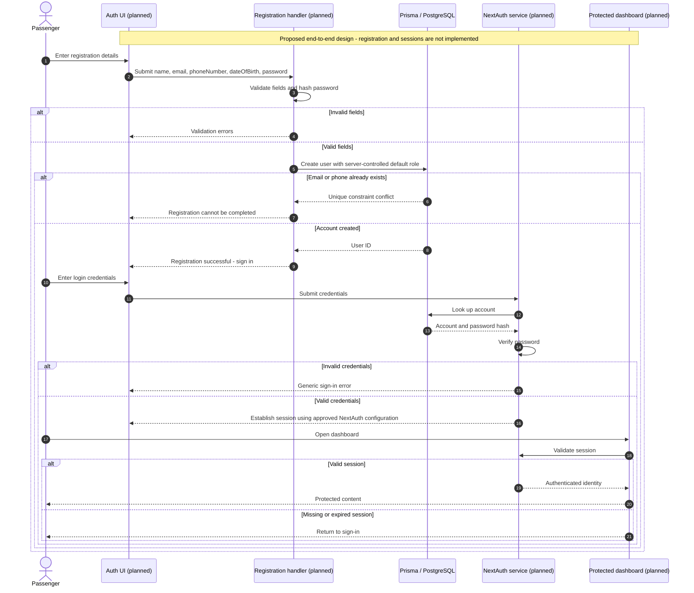
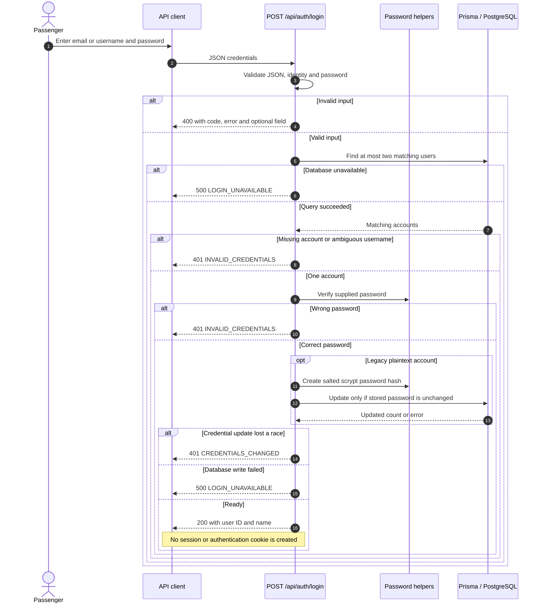

# Auth sequence diagram — Mohammed Alasad

Assignment: 10 October 2026. Reviewed against `main` at `b4e6d25` on 15 October 2026.
Prepared for Mohamed Elshiekh's combined UML document; delivery/acceptance is not claimed.

## Required register → login → session design (planned)

The README proposes NextAuth, but this repository has no registration endpoint, NextAuth dependency/configuration, session endpoint or protected dashboard implementation. The diagram below is a **design draft**, not a claim these steps are delivered. The week explicitly prohibits starting new features. Confirm this intended design with the architecture owner before implementing registration/sessions; the implemented login behavior is shown separately below.

`dateOfBirth` is required by the current User model. Session storage/lifetime and frontend routes remain architecture decisions; this draft does not invent a session table or implemented route.

## Implemented login sequence

## Existing recovery behavior

The client submits its email to `/api/auth/forgot-password`, which returns the same support instructions for known and unknown accounts. After identity verification an operator runs `scripts/issue-password-reset.ts` and privately delivers a 15-minute token. `/api/auth/reset-password` validates the token and new password and uses an atomic compare-and-set update; a successful update invalidates all tokens bound to the old password. The user then signs in again. No email is sent automatically. See [API handoff](auth-hotels-cars.md) for error codes and configuration.

Source trace: `app/api/auth/login/route.ts`, `lib/auth-http.ts`, `lib/passwords.ts`, `lib/password-reset.ts`, `prisma/schema.prisma`. No registration or session functionality was added to make the diagram appear implemented.
