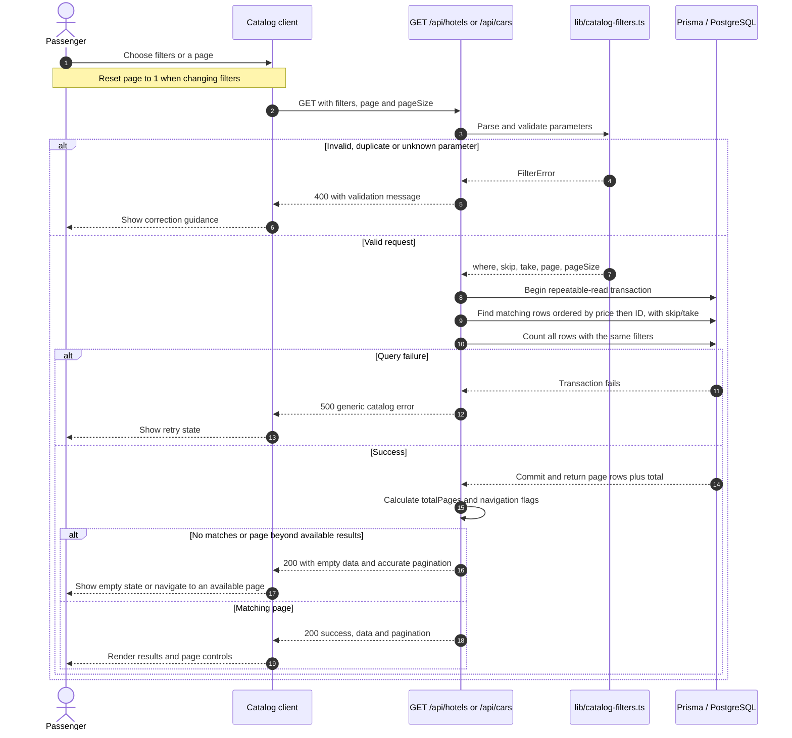

# Hotels/Cars search and filter sequence — Mohammed Alasad

Assignment: 11 October 2026. Verified against the implementation on 15 October 2026.
Prepared for Mohamed Elshiekh's combined UML document; delivery/acceptance is not claimed.

Both catalogs use the same interaction pattern. The UI participant describes a consuming client; no completed frontend integration is claimed.

- Hotels: inclusive nightly `minPrice`/`maxPrice`, inclusive `minRating`, case-insensitive exact `roomType` and `city`.
- Cars: inclusive daily `minPrice`/`maxPrice`, case-insensitive exact `category`.
- Filters combine with AND. Text is trimmed; SQL pattern characters are literal text, not wildcard searches.
- Default `page=1`, `pageSize=20`; maximum page size is 100. Offset is `(page - 1) * pageSize`.
- `total` counts filtered inventory before pagination; `totalPages = ceil(total / pageSize)`.
- One response uses a consistent transaction snapshot. Separate page requests can reflect changed inventory.
- Decimal prices serialize as strings. Catalogs use stored sample data and perform no booking, availability reservation or payment.

Source trace: `app/api/hotels/route.ts`, `app/api/cars/route.ts`, `lib/catalog-filters.ts`, `lib/prisma.ts`, `tests/endpoints.integration.ts`.
